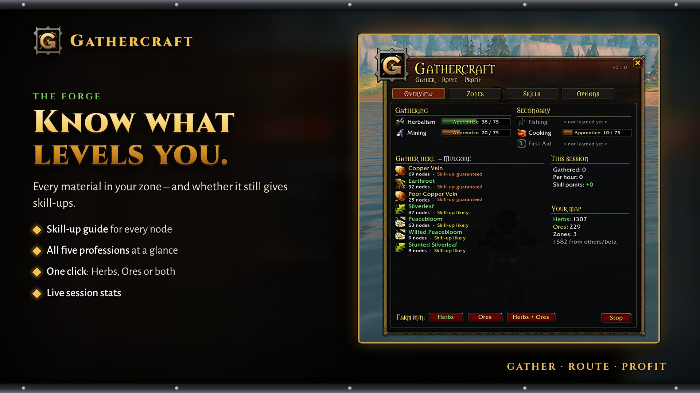
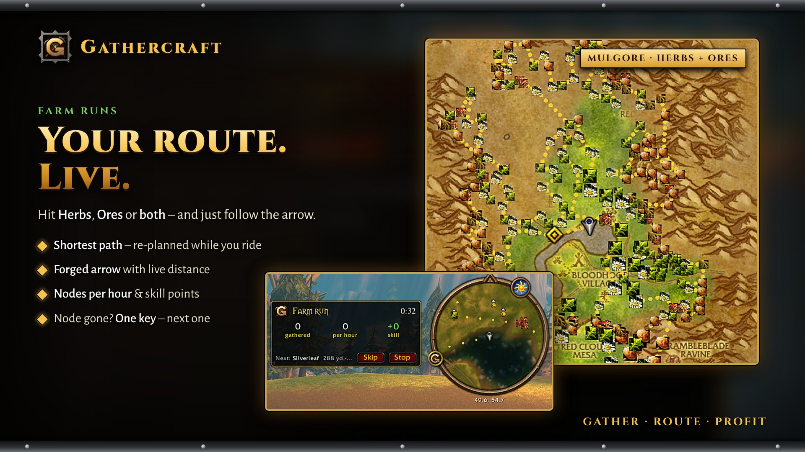
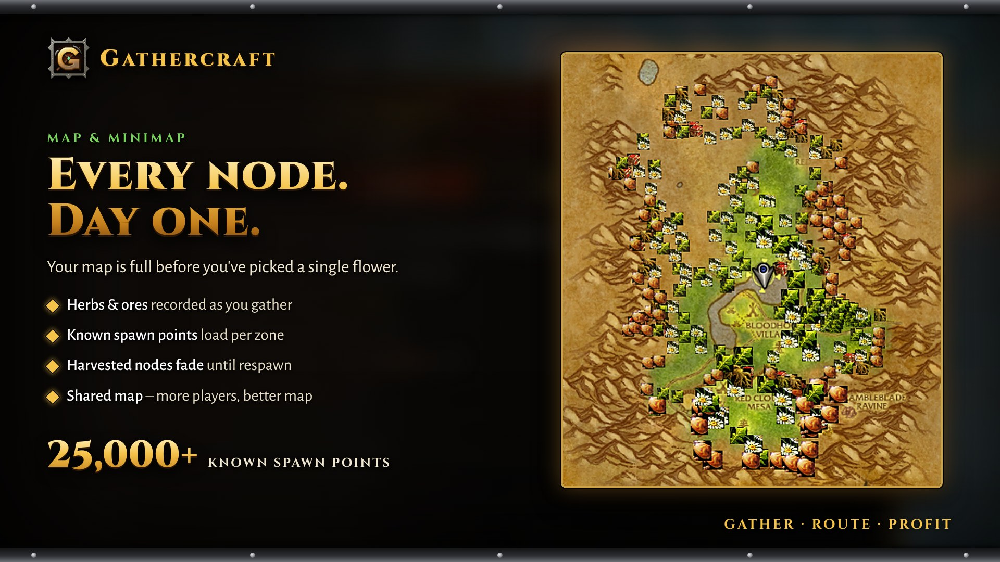
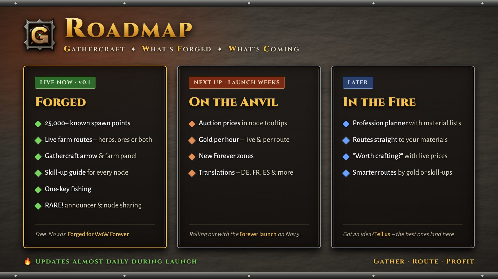

  

<h3 align="center"><i>Peacebloom fears you now.</i></h3>

  The free gathering companion for <b>World of Warcraft: Forever</b>. 
  Every node on your map. A live route through all of them. One key for fishing. An announcer that roars <i>"RARE!"</i>.

  
  

---

## ⚔️ Without Gathercraft vs. with Gathercraft

| Without | With Gathercraft |
|---|---|
| *"Wasn't there a vein around here somewhere?"* | Every node is pinned on your map and minimap, plus **25,000+ known spawn points** from day one. |
| You arrive, the herb is gone, you guess where to go next | Your route **re-plans live while you ride**. Taken? One key, next node. |
| You farm nodes that stopped giving skill-ups ages ago | You see **which nodes still level you**, right in the overview. |
| Your guild mate found a rich zone, you never hear about it | Optional **shared node map** with guild and friends. |
| Click, wait, hunt the bobber, click, re-apply lure… | **One key.** Pole, lure, cast, reel in. |
| The rare you hunted for days walks by while you're in chat | **"RARE!"** You hear it before you see it. |

## 🔥 Features

**🗺️ The Map That Never Forgets**
Herbs and ores are recorded the moment you gather them, no setup. Known spawn points for every classic zone load as you explore. Harvested nodes fade until they respawn.

**🧭 The Route That Thinks Ahead**
Pick *Herbs*, *Ores* or *both*, or fine-tune zones and single materials. Gathercraft plans the shortest path through everything on your continent and keeps re-planning while you move. Follow the forged Gathercraft arrow or Blizzard's waypoint.

**⚒️ The Forge**
Your main window: bars for Herbalism, Mining, Fishing, Cooking and First Aid, *"Gather here"* with everything in your current zone and whether it still gives skill-ups, live session stats.

**⏱️ Farm panel**
While you farm: run time, nodes gathered, nodes per hour, skill points gained.

**🎣 One Key. One Fish. Repeat.**
Bind one key: it equips your pole, applies your best lure, casts and reels in. Every press is one action – you're always in control.

**👁️ RARE!**
A rare shows up and an announcer roars **"RARE!"**, with a warning across your screen. Runs only on your client.

**🤝 Stronger Together**
Optional node sharing. Guild and friends are trusted instantly, strangers need confirmations.

## 🎒 Getting started

1. Install from CurseForge or Wago *(coming soon)*, or copy the `Gathercraft` folder into `World of Warcraft\_classic_\Interface\AddOns`.
2. Log in and gather something – the pin appears.
3. Click the emblem on your minimap → **Overview** → *Farm run: Herbs / Ores / Herbs + Ores*.
4. Follow the arrow.

## 🎮 Controls

**Everything lives in the Gathercraft window** – click the emblem on your minimap or type `/gcr`.

| | |
|---|---|
| **Overview** | Your professions, what to gather in this zone, one-click farm runs |
| **Zones** | Pick zones and single materials for your routes |
| **Skills** | Which nodes gave you skill-ups so far |
| **Options** | Arrow, route line, sharing, RARE! alert, fishing, minimap button |

**Key bindings:** Options › Keybindings › AddOns › Gathercraft – *Fish · Start/stop run · Skip node*

## ❓ FAQ

**Does it play for me?** No. You ride, you gather, you press the keys. Gathercraft only shows information and points the way.

**Can it see nodes nobody has found?** No. It knows what you, other players and the known spawn data have found. No hidden spawns, no tricks.

**What does sharing send?** Node positions only (object, zone, coordinates). Nothing about your character. Off with one click.

**What does it cost?** Nothing. Free, no paid features.

## 🗺️ Roadmap

Gathercraft is **actively developed** – during the Forever launch weeks expect **updates almost every day**. Here's what's coming:

**✅ Live now (v0.1)**
- Node recording, map & minimap pins, 25,000+ known spawn points
- Live farm routes with the Gathercraft arrow and farm panel
- Skill-up info per node, one-key fishing, RARE! announcer, optional node sharing

**🔨 Next up (launch weeks)**
- **Auction house prices** in node tooltips (via Auctionator)
- **Gold per hour** – live in the farm panel, per route
- **New Forever zones** – Zephras Isle, Darkspear Islands, Riverglades & co.
- **Translations** – German, French, Spanish and more

**🔮 Later**
- **Profession planner** – pick a target skill, get the material list, and Gathercraft routes you straight to it
- **"Is it worth crafting?"** – sell raw or craft first, with live prices
- **Smarter routes** – plan by expected gold or skill-ups, not just distance

*Got an idea? Tell us – the best ones end up on this list.*

## 🐛 Bugs & ideas

Open an [issue](../../issues) – please add your Gathercraft version and what you were doing.

## ☕ Fuel the Forge
Gathercraft is free and always will be. No paid features, no ads, no pop-ups.
But every route needs a smith – and every smith needs coffee.

**If Gathercraft saved you an hour of riding in circles, buy me a coffee and keep the forge burning:**

*Every coffee goes straight into new features – and maybe a voice actor for the next "RARE!".*

## 📜 License

Gathercraft's own code is released under the [MIT License](LICENSE).
The node data in `Data/QuestieNodes.lua` comes from [Questie](https://github.com/Questie/Questie) and is used with permission of the Questie team; it is **not** covered by the MIT license. Libraries in `Libs/` keep their own licenses.

## ❤️ Credits

- Made by **pheenixlawl**
- Node data from [Questie](https://github.com/Questie/Questie), used with permission
- [HereBeDragons](https://github.com/Nevcairiel/HereBeDragons), [LibDataBroker](https://github.com/tekkub/libdatabroker-1-1) and LibDBIcon

 <b>Gather. Route. Profit.</b>

World of Warcraft is a trademark of Blizzard Entertainment. Gathercraft is a fan-made addon and is not affiliated with Blizzard.
