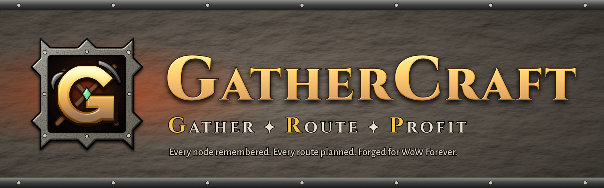
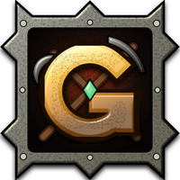

  

<h3 align="center"><i>Peacebloom fears you now.</i></h3>

  The free gathering companion for <b>World of Warcraft: Forever</b>. 
  Every node on your map. A live route through all of them. One key for fishing. A voice that shouts <i>"Rare!"</i>.

---

## ⚔️ Without Gathercraft vs. with Gathercraft

| Without | With Gathercraft |
|---|---|
| *"Wasn't there a vein around here somewhere?"* | Every node is pinned on your map and minimap, plus **25,000+ known spawn points** from day one. |
| You arrive, the herb is gone, you guess where to go next | Your route **re-plans live while you ride**. Taken? One key, next node. |
| You farm nodes that stopped giving skill-ups ages ago | You see **which nodes still level you**, right in the overview. |
| Your guild mate found a rich zone, you never hear about it | Optional **shared node map** with guild and friends. |
| Click, wait, hunt the bobber, click, re-apply lure… | **One key.** Pole, lure, cast, reel in. |
| The rare you hunted for days walks by while you're in chat | **"RARE!"** You hear it before you see it. |

## 🔥 Features

**🗺️ The Map That Never Forgets**
Herbs and ores are recorded the moment you gather them, no setup. Known spawn points for every classic zone load as you explore. Harvested nodes fade until they respawn.

**🧭 The Route That Thinks Ahead**
Pick *Herbs*, *Ores* or *both*, or fine-tune zones and single materials. Gathercraft plans the shortest path through everything on your continent and keeps re-planning while you move. Follow the forged Gathercraft arrow or Blizzard's waypoint.

**⚒️ The Forge**
Your main window: bars for all professions, *"Gather here"* with everything in your current zone and whether it still gives skill-ups, live session stats.

**⏱️ Farm panel**
While you farm: run time, nodes gathered, nodes per hour, skill points gained.

**🎣 One Key. One Fish. Repeat.**
Bind one key: it equips your pole, applies your best lure, casts and reels in. Every press is one action – you're always in control.

**👁️ RARE!**
A rare shows up and a deep voice calls it out, with a warning across your screen. Runs only on your client.

**🤝 Stronger Together**
Optional node sharing. Guild and friends are trusted instantly, strangers need confirmations.

## 🎒 Getting started

1. Install from CurseForge or Wago *(coming soon)*, or copy the `Gathercraft` folder into `World of Warcraft\_classic_\Interface\AddOns`.
2. Log in and gather something – the pin appears.
3. Click the emblem on your minimap → **Overview** → *Farm run: Herbs / Ores / Herbs + Ores*.
4. Follow the arrow.

## 📖 Commands

| Command | |
|---|---|
| `/gcr` | Open Gathercraft |
| `/gcr run [herb\|ore\|both\|name]` | Start a farm run |
| `/gcr route` | Preview the route on the map |
| `/gcr skip` / `/gcr stop` | Next node / stop the run |
| `/gcr loadall` | Load known spawn points for the whole continent |
| `/gcr pins` | Show / hide map pins |
| `/gcr sync` | Node sharing status and settings |
| `/gcr rare` | Test the rare alert |

**Key bindings:** Options › Keybindings › AddOns › Gathercraft – *Fish · Start/stop run · Skip node · Zones*

## ❓ FAQ

**Does it play for me?** No. You ride, you gather, you press the keys. Gathercraft only shows information and points the way.

**Can it see nodes nobody has found?** No. It knows what you, other players and the known spawn data have found. No hidden spawns, no tricks.

**What does sharing send?** Node positions only (object, zone, coordinates). Nothing about your character. Off with one click.

**What does it cost?** Nothing. Free, no paid features.

## 🛠️ On the anvil

- Profession planner with material lists for your next skill-ups
- Market: auction prices, gold per hour **per route**, "is it worth crafting?"

## 🐛 Bugs & ideas

Open an [issue](../../issues) – please add your Gathercraft version and what you were doing.

## ❤️ Credits

- Made by **pheenixlawl**
- Node data from [Questie](https://github.com/Questie/Questie), used with permission
- [HereBeDragons](https://github.com/Nevcairiel/HereBeDragons), [LibDataBroker](https://github.com/tekkub/libdatabroker-1-1) and LibDBIcon

 <b>Gather. Route. Profit.</b>

World of Warcraft is a trademark of Blizzard Entertainment. Gathercraft is a fan-made addon and is not affiliated with Blizzard.
